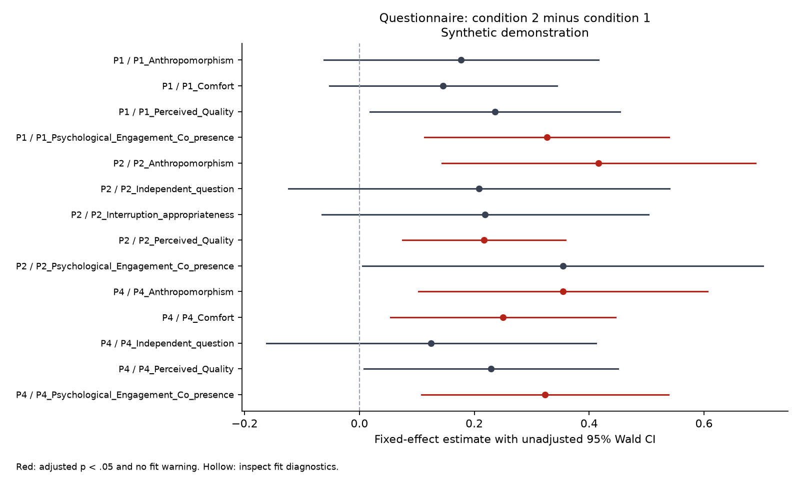

# Digital Human Interaction Evaluation

[English](README.md) | [简体中文](README.zh-CN.md)

**Chinese name:** 数字人交互效果评测 · **Repository/package name:** `digital-human-interaction-evaluation` · **Software license:** [MIT](LICENSE)

Python analysis of questionnaire responses and facial Action Unit (AU) measurements in human–agent interaction. The workflow constructs questionnaire dimensions, aligns facial measurements with interruption events, and estimates condition effects and personality-by-condition interactions using linear mixed-effects models.

The motivating study used a Wizard-of-Oz digital human at Xi’an Jiaotong-Liverpool University. This repository covers evaluation and analysis. It contains no digital-human rendering platform, autonomous LLM agent, model training, or participant recordings.

**Release status:** local public-review candidate with an MIT license selected by the maintainer. Original code ownership and authority to redistribute the adapted team code still require confirmation. See [release status](docs/release-status.md). The implemented `archived_notebooks` profile follows the available analysis notebooks. Its differences from the published methods are documented in [methods](docs/methods.md). Synthetic examples demonstrate software behavior and do not reproduce the paper's findings.

## Run a synthetic example

Use Python 3.11 or newer and an isolated environment:

```sh
python -m venv .venv
```

Activate it with `.\.venv\Scripts\Activate.ps1` in Windows PowerShell, or `source .venv/bin/activate` in macOS/Linux. Then run:

```sh
python -m pip install -e .
python -m hci_eval demo --out results/demo
python -m unittest discover -s tests -v
```

Choose a new, empty output directory on subsequent runs. The demo generates synthetic people, questionnaire responses, facial measurements, and interruption events independently of real participant records. The generator's seed is fixed by default; `--seed` selects another reproducible demonstration.

The outputs include dimension scores, pooled questionnaire reliability, AU session means, condition and trait effects, raw and adjusted p-values, fit diagnostics, and forest plots. `run_report.json` records the analysis profile and whether the input was generated by the demo. Inspect fit diagnostics before interpreting any estimate: nonconvergence, singularity and covariance warnings are retained.

## Verified example outputs

On the tested Windows/Python 3.12 environment, all 16 tests passed and the installed package completed the synthetic pipeline. The run fitted 156 models and produced three plots. All 72 AU fits had boundary warnings, including five nonconverged fits; those effects remain flagged for review. Software execution success does not validate those estimates or reproduce published findings.

See [example outputs](examples/model-output/README.md) and [verification details](docs/validation.md). To recreate the tested dependency set in the same Python 3.12 environment, install `requirements-tested.txt` before installing the package:

```sh
python -m pip install -r requirements-tested.txt
python -m pip install -e .
```



## Analyze your own local data

Prepare the canonical inputs described in [data schema](docs/data-schema.md):

```sh
python -m hci_eval run --questionnaire private_data/questionnaire.csv --frames private_data/frames.csv --events private_data/events.csv --out results/local
```

The input files are read only. Output files are written to the dedicated directory. Keep real participant data outside the public repository; the `private_data/` and `results/` paths are ignored by Git. `.gitignore` is a convenience and does not replace a release review.

## Analysis flow

1. Validate record keys, score ranges and person-level metadata.
2. Preserve raw questionnaire scores, apply the archived item rules, and construct complete-item dimension composites.
3. Center Big Five traits at the deduplicated participant level.
4. Aggregate four facial AUs across the full session or interruption-window union, depending on original phase.
5. Fit condition-only and trait-moderation mixed models with age, gender and sequence covariates.
6. Apply the explicitly documented notebook correction families and export fit diagnostics and plots.

Questionnaire and AU outcomes are modeled separately using shared metadata. The repository does not implement a learned multimodal fusion model. Interview transcripts and qualitative coding records are excluded.

## Repository guide

| Path | Purpose |
| --- | --- |
| `src/hci_eval/questionnaire.py` | Original item map, scoring, dimension construction and reliability |
| `src/hci_eval/openface.py` | Event merging, nearest-frame alignment and AU aggregation |
| `src/hci_eval/statistics.py` | BH/Holm adjustment, Wald contrasts and diagnostic mixed-model fitting |
| `src/hci_eval/modeling.py` | Model C/Model T and correction-family construction |
| `src/hci_eval/validation.py`, `qc.py` | Schema validation, covariate consistency and quality observations |
| `src/hci_eval/data.py` | Non-destructive participant selection |
| `src/hci_eval/pipeline.py`, `__main__.py` | CSV pipeline and command-line entry point |
| `src/hci_eval/plotting.py` | Forest plots with adjusted-significance and fit-review markers |
| `src/hci_eval/synthetic.py`, `data/demo/` | Independent synthetic generator and example inputs |
| `examples/analysis_walkthrough.ipynb` | Readable preprocessing walkthrough with no saved outputs |
| `examples/preprocessing-output/` | Synthetic dimension scores, AU aggregates, reliability and quality report |
| `examples/model-output/` | Synthetic model tables, forest plots and run report |
| `tests/` | Scoring, time boundaries, corrections and diagnostic behavior |
| `docs/` | Methods, schemas, provenance and release limitations |
| `pyproject.toml`, `requirements-tested.txt` | Package metadata and tested dependency versions |
| `CITATION.cff`, `LICENSE` | Research citation metadata and MIT license |

## Research context and attribution

The research was a team collaboration. Jingyu Ye and Xichun Xu contributed equally to the ECSCW article. The digital-human platform was developed by other team members. Original notebook authorship and software redistribution rights are being reconciled; publication author order does not establish sole code authorship. This 2026 software adaptation was prepared with AI assistance and should be attributed separately from the original study.

Related publications:

- Ye et al. (2026). *“Because I Know It Is an AI”: How User Personality and AI-Schema Shape the Social Contract of Digital Humans*. [ECSCW article](https://doi.org/10.48340/ecscw2026_108).
- *Evaluating User Preferences for Gender and Embodiment Scope in Human-Agent Interaction Systems*. [ICHEC article](https://doi.org/10.1145/3786995.3787057).
- *When Virtual Eyes Meet Human Personality: An Empirical Study On How Personality Shapes Gaze Perception*. [ICHEC article](https://doi.org/10.1145/3786995.3787058).

The two ICHEC papers provide research context; their complete analysis pipelines are not included in this mainline repository. A paper's license does not automatically license every code file or dataset.

## License

The software and accompanying documentation in this candidate are declared under the [MIT License](LICENSE), using collective contributor attribution. MIT permits reuse, modification and redistribution, including commercial use, with preservation of the copyright and permission notices. The software is provided without warranty. Selecting this license does not establish ownership or consent for the archived team code; those provenance questions remain recorded in [release status](docs/release-status.md).

This declaration does not relicense the related publications, original participant data, recordings, external OpenFace software or other third-party materials, none of which are bundled here. The committed synthetic inputs and generated demonstration outputs are included in this candidate's distribution.

For Chinese readers, see [中文说明](README.zh-CN.md). Software verification results are recorded in [validation](docs/validation.md).
